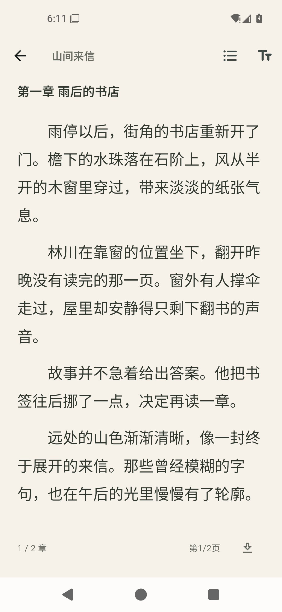
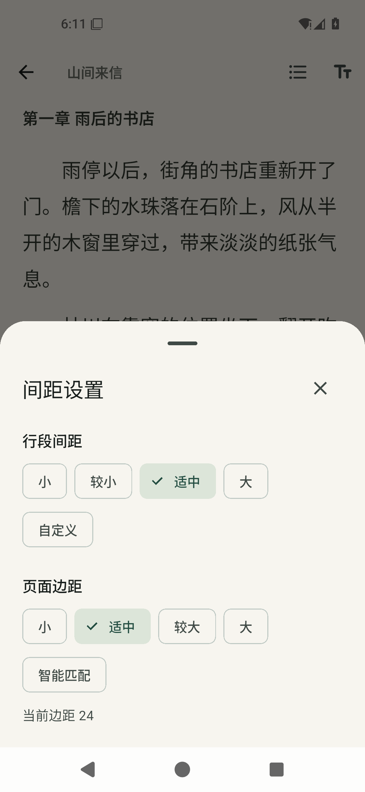
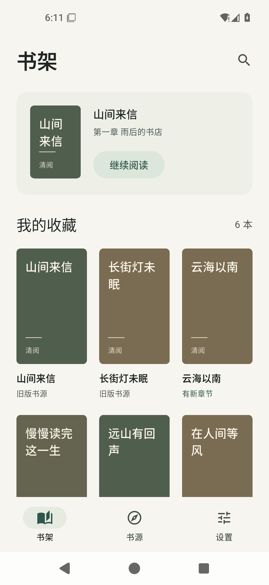

# 清阅

面向安卓手机的小说阅读 App。支持笔趣阁 631、酷我小说和新笔趣阁三个来源，书架、阅读进度和已缓存章节保存在本机。

当前维护仓库：[thisismineds/biquge](https://github.com/thisismineds/biquge)。原项目来自 leetomlee123/biquge。

## 2.0 更新

### 2.0.2 缓存进度

缓存按钮改为圆环，圈内仅显示百分比，适配上千章小说；已缓存数量放在章节目录标题旁，例如“共 982 章 已缓存 294 章”。详情正文下方不再显示缓存数字。完整 39 项测试通过。[查看缓存进度与正式包验证记录](docs/cache-progress-2.0.2.md)。

### 2.0.1 修复

修复正式安装包切入全屏后仍使用旧分页高度的问题。现在按实际宽高重排正文，并保留阅读位置；完整 33 项测试通过。[查看修复与正式包验证记录](docs/fullscreen-fix-2.0.1.md)。

- 升级到 Flutter 3.47.9 / Dart 3.13.7，完成空安全、Dio 5 和 Android embedding v2 迁移。
- 书架、搜索、书源与设置改为米白、墨绿的 Material 3 界面。
- 阅读页保留原来的五种背景色及背景设置；重点调整字号、行距、段间距、首行缩进与页边距。
- 分页和显示使用相同的字体、缩放及段落布局参数，避免放大字号后文字挤出页面。
- 保留旧书架、章节缓存和阅读进度；重新排版时按正文位置恢复，不把其他来源的相同编号混用。
- 设置中新增独立“间距设置”：行段间距支持小、较小、适中、大、自定义；页面边距支持小、适中、较大、大、智能匹配。自定义数值与选择会保存，智能匹配按实际屏幕宽度留白。
- 字号、夜间模式和原有背景可继续调整；保留书源和离线缓存功能。

## 界面与验证

界面截图使用示例书籍和原创示例正文，不是用户书架：

  

完整验证见 [2.0 验证记录](docs/validation-flutter3-2026-11-10.md)：31 项测试通过，静态检查无问题，三个书源在线抽查及模拟器覆盖安装验证通过。

## 环境

- Flutter **3.47.9**，Dart **3.13.7**。
- Android **7.0 / API 24 及以上**；应用包名仍为 `com.example.qingyue`。
- JDK 17、Android SDK 36、NDK 28.2.13676358。
- Android Gradle Plugin 9.1.0、Gradle 9.3.1。

```sh
flutter pub get
flutter analyze
flutter test
dart run tool/check_sources.dart
flutter build apk --release --target lib/main.dart
```

`tool/check_sources.dart` 会逐一抽查三个来源的搜索、详情、目录和首章正文，只输出书籍信息及正文长度，不输出正文。

## 签名与更新

正式发布时使用自己的 `android/key.properties` 和签名文件，均不应提交仓库。只在本地测试升级时，可以用 `QINGYUE_DEBUG_KEYSTORE` 显式指定之前使用的调试签名；使用同一包名、同一签名且版本号递增，才能覆盖安装并保留应用数据。

本次交付使用与 1.0 安装包相同的测试签名。未上传应用商店。

## 代码

- `lib/service/book_sources.dart`：三个站点的数据适配、备用域名及缓存键约定。
- `lib/entity/` 中的 Book、BookInfo、BookTag、Chapter：兼容旧设备记录的 JSON 模型。
- `lib/storage/app_store.dart`：本地书架、缓存、设置及阅读记录。
- `lib/reader/`：正文分段、测量、分页和阅读设置。
- `lib/ui/`、`lib/app/`：新版界面与主题。
- `test/`：书源、旧记录兼容、分页及阅读交互回归测试。

原 Flutter 1 界面仍保留于 `lib/view` 等旧目录作为迁移参考；不由新入口引用，也不参与新版静态检查。新版本入口为 `lib/main.dart`。

`tool/preview_app.dart` 是开发用界面预览入口，使用内存中的示例书籍和原创示例文字，不写入用户书架。交付 APK 始终从 `lib/main.dart` 构建。

书源是第三方网站，可能随时变化。本次抽查不代表所有书籍和全部章节长期可用。
