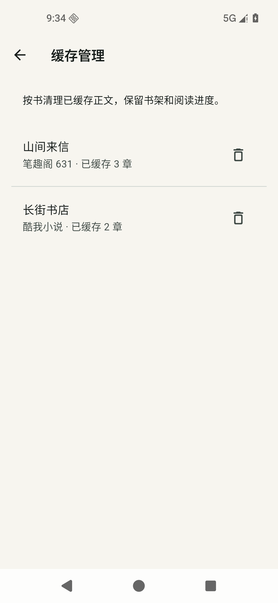
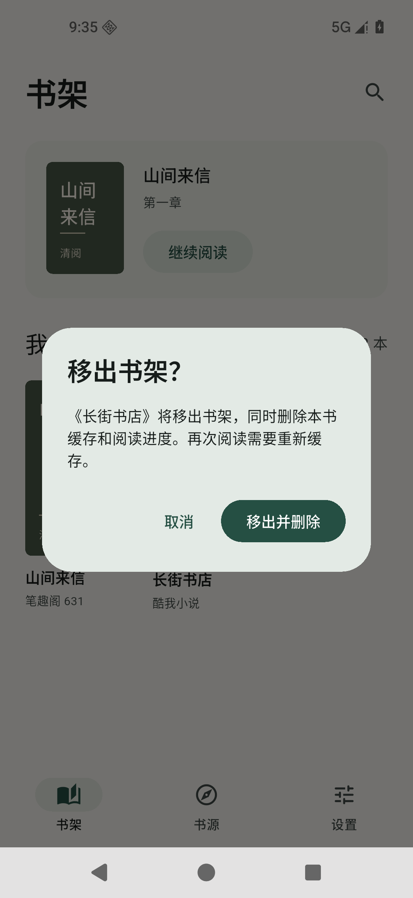

# 2.0.3 本地缓存管理

## 行为

- 书架长按书籍，选择“移出书架”，确认后删除本书正文缓存、目录、书籍信息与阅读记录；其他书源中同编号的书不受影响。
- 设置 → 本地保存 → 缓存管理，显示书名、书源及实际已缓存章数。单本删除缓存会保留书架、目录与阅读位置，下次阅读重新获取正文。
- 阅读记录内保存的重复正文也一起清理。清理发生前的下载响应不能重新写入缓存，正在进行的批量缓存会停止。
- 支持旧版目录关联的正文缓存，以及此前移出书架仍有记录的缓存书籍；无法识别归属的旧版孤立数据不做推测性删除。

## 实现与验证计划

1. 在 AppStore 统一实现缓存列举、按书清理与移出清理；使用书源和书籍编号限定现代缓存键，旧版使用目录关联章节。
2. 以测试验证跨书源隔离、保留阅读位置、删除重复正文、旧版缓存、旧版本残留缓存、清理时网络请求返回的竞争情况。
3. 连接设置入口与书架操作，验证取消、确认、空列表、删除失败的提示。
4. 运行完整测试与静态检查，构建正式安装包，提交到用户仓库并复制到 Windows 桌面。

## 验证结果

2026-11-10：完整 49 项 Flutter 测试通过，静态检查无问题，正式 APK 构建成功。新增 10 项测试覆盖清理、移出确认与取消、跨书源和编号边界隔离、旧版本残留缓存、旧版数字键冲突、网络请求与清理竞争，以及清理后重新打开保留正文位置。

Android 16 / API 36 模拟器验证使用示例书籍“山间来信”和“长街书店”，正文为原创示例文字。两本书来自不同书源且编号相同。删除第一本的缓存后，书架仍有两本、第一本正文键为零、阅读位置保留、第二本两章缓存不变；覆盖安装最终正式 APK 后，移出第二本，验证其书籍信息、目录、进度、缓存键均已删除，第一本仍在书架。

截图直接来自模拟器，未编辑图像。尚未在华为实体手机上验证。

 

版本：2.0.3+5；使用与此前交付相同的测试签名，可覆盖安装。
