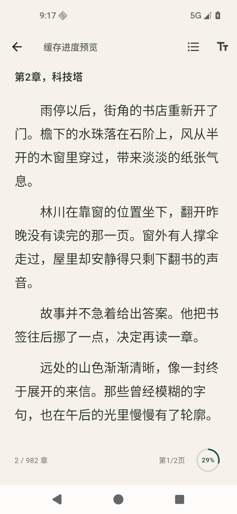
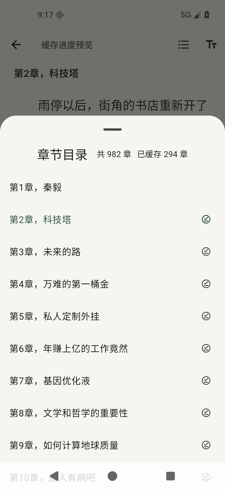

# 2.0.2 缓存进度

缓存按钮点击后显示圆环，圈内只显示整数百分比。章节总数再大也不把分数挤进圈内；准备目录时显示等待状态，全部完成后显示完成图标。按钮保留至少 48dp 点击区域及无障碍进度描述。

章节目录标题旁显示“共 N 章 已缓存 M 章”，按本机实际保存且非空的正文统计。正文保存成功后刷新数量。详情正文下方不再显示章节缓存数字。

- 详情页缓存整本书，保留暂停与继续；暂停期间返回的请求仍会保存正文并刷新进度，不会覆盖新任务状态。
- 阅读页缓存当前章到末章，已缓存的章节直接跳过。两个入口都从实际已有缓存起算，网络失败沿用错误提示与重试入口。
- 缓存键、书架、阅读进度和阅读背景沿用原规则。

## 验证

2026-11-10：完整 39 项 Flutter 测试通过，静态检查无问题，正式 APK 构建与签名检查通过。新增测试覆盖 12,500 章百分比、等待与完成状态、双倍系统字号、目录随保存更新、详情暂停继续，以及暂停后未完成请求返回的情况。

Android 16 / API 36 模拟器使用 `lib/main.dart` 构建的正式 APK 验证。演示书名与正文为示例数据；目录有 982 章，预先设置 290 章缓存，再实际下载保存 4 章。截图中按钮显示 29%，目录显示“共 982 章 已缓存 294 章”。截图直接来自模拟器，未编辑图像。未在华为实体手机上验证。

 

版本：2.0.2+4；安装包使用与此前交付相同的测试签名，可覆盖安装。
